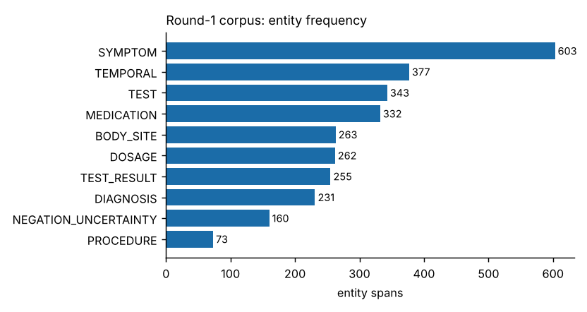
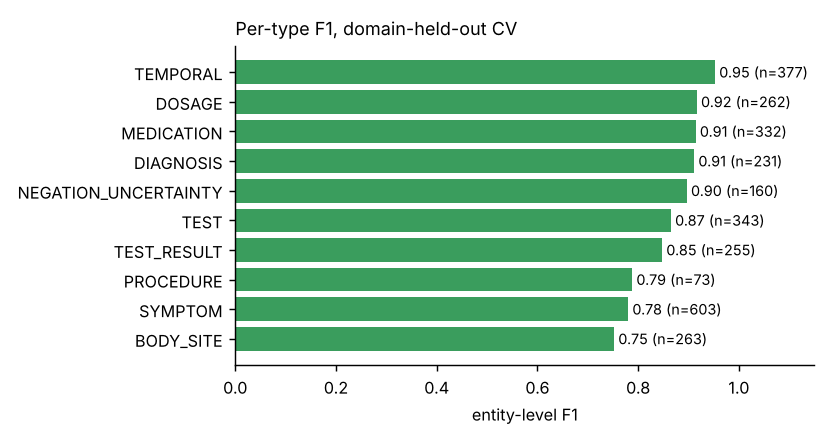
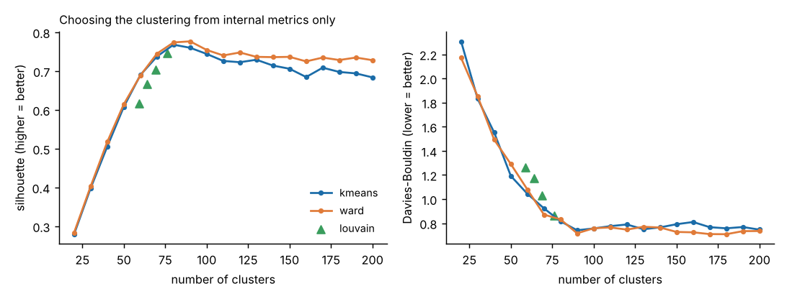
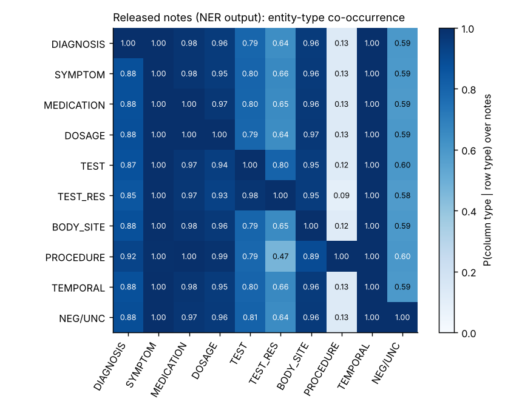

# 1. Summary

We built an end-to-end, **offline and deterministic** Bengali clinical NLP pipeline and packaged it as one runnable notebook (`MedBhasha_Pipeline.ipynb`):

1. **Data.** After the organisers' feedback (40 notes / 612 tokens in Round 1, target ≈ 10 000 tokens) we grew our own annotated corpus to **232 notes / 12060 tokens / 2899 entity spans** covering 23 clinical domains and all 10 entity types (rarest type: PROCEDURE = 73 spans). The corpus passes the official `validate.py` with 0 errors and 0 warnings.
2. **NER.** A lexicon-augmented, section-aware linear-chain CRF. Cross-validated entity-level F1 on our own data: **0.876** (random 5-fold) and **0.861** (whole clinical domains held out).
3. **Clustering.** Unsupervised clustering of the 1691 released notes from their predicted entities: **90 clusters** (ward, chosen by internal metrics only), silhouette **0.777**, Davies–Bouldin **0.717**.
4. **RAG.** Retrieval over our annotated notes (+ the released notes annotated by our own NER model) with grounded, extractive Bengali answers and `[note-id]` citations for the 30 test queries; a live-query function for the finale. No external API, no web retrieval, no pretrained generator.

**Three caveats we want the reader to see first.**

* All our training data are *synthetic and written by one author (an LLM, with the team)*; no clinician reviewed the annotations. Cross-validated scores are therefore an **upper bound** — the hidden test F1 will very likely be lower, especially if the organisers' gold uses other span conventions (§4.6).
* The RAG rule says "retrieve from your own annotated corpus only". The queries ask for *patients*, which only the released notes can supply. We therefore provide **two answer files** — released notes annotated by our own NER (default) and strictly team-corpus-only — and ask the organisers to confirm the intended reading (§6.5).
* We looked at a small number of released notes and the header statistics to learn the *format* of the notes (sections, shorthand headers such as `C/O`, `Dx`, `Rx`). We did not copy, annotate or train on any released text (verified: maximum character-5-gram Jaccard between any training note and any released note is **0.28**).

# 2. Rule compliance at a glance

| Rule / requirement | How we comply |
|---|---|
| Approved sources only; source declaration with annotation method | 100 % synthetic team-authored notes; `round1_deliverables/SOURCE_DECLARATION.md` lists every batch and discloses *LLM-assisted manual drafting* (no rule-based tool, no clinician review). |
| Entity schema + BIO format, mandatory `validate.py` report | `data/round1/annotated_corpus.csv` (columns `note_id,token,tag`); report in `round1_deliverables/validation_report.txt`; prediction file validated too (`outputs/ner_predictions_validation_report.txt`). |
| EDA summary | `round1_deliverables/EDA_Summary.pdf` (+ §3.4 below). |
| NER trained on the team's **own** Round-1 annotations | CRF trained only on `annotated_corpus.csv`; **no pretrained model, no external data, no use of the released notes for training**. |
| Clustering unsupervised, features from NER output | Representation uses predicted entities only; model selection by silhouette / Davies–Bouldin only. |
| RAG: team's own corpus only, no external API / web | Everything local; knowledge base = our notes (+ released notes annotated by our NER); strict variant provided. |
| One runnable notebook; exact reproduction | `MedBhasha_Pipeline.ipynb`; fixed seed 42; every output hashed in `outputs/run_manifest.json`; `scripts/check_reproducibility.py` re-runs everything under a different `PYTHONHASHSEED` and compares hashes. |
| Cite tools / pretrained models | No pretrained models. Libraries: NumPy, pandas, SciPy, scikit-learn, CRFsuite via `sklearn-crfsuite`, `seqeval`, NetworkX, Matplotlib. The synthetic notes and span annotations were drafted by Claude (Anthropic) in conversation with the team; disclosed in the source declaration. |

# 3. Data

## 3.1 From Round 1 to Round 2

The Round-1 submission had 40 notes (612 tokens) and most entity types had < 30 mentions. The organisers recommended ≈ 10 000 tokens, prioritising rare entity types, and noted that few-shot LLM approaches work better on tiny corpora. We did the following:

* kept the 40 Round-1 notes (`n001–n040`) and **fixed 8 inconsistent tags** (`round1_fixes_log.tsv`), e.g. dosage forms such as `ইনহেলার` moved into the MEDICATION span, `ফলো-আপ` removed from TEMPORAL;
* wrote **192 new notes** (`n041–n232`) in 9 batches, deliberately mixing registers: long structured outpatient notes, admission/discharge summaries, shorthand notes (`C/O … O/E … Dx … Rx … Adv … F/U`), and very short informal first-person notes;
* repaired the metadata file: the Round-1 `note_metadata` covered only 20 notes with stale domain labels; the new `data/round1/note_metadata.csv` covers all 232 notes.

## 3.2 Annotation method (disclosure)

*LLM-assisted manual drafting.* The assistant wrote notes and entity spans as inline markup (`{DX|ডায়াবেটিস}`), a deterministic script aligned spans to tokens and produced BIO tags (it refuses spans that cut tokens, overlap, or contain punctuation). No clinician reviewed anything; there is **no inter-annotator agreement**. All decisions are documented in `docs/ANNOTATION_CONVENTIONS.md`. Source category: *synthetic clinical notes generated by the team* — no real patient data, no EHR, no web text.

## 3.3 Corpus statistics

| entity type | spans | distinct forms | notes containing | share % |
|--------------------------|--------|----------------|------------------|---------|
| SYMPTOM | 603 | 221 | 206 | 20.8 |
| TEMPORAL | 377 | 114 | 193 | 13.0 |
| TEST | 343 | 144 | 162 | 11.8 |
| MEDICATION | 332 | 184 | 173 | 11.5 |
| BODY_SITE | 263 | 147 | 169 | 9.1 |
| DOSAGE | 262 | 135 | 153 | 9.0 |
| TEST_RESULT | 255 | 188 | 151 | 8.8 |
| DIAGNOSIS | 231 | 179 | 189 | 8.0 |
| NEGATION_UNCERTAINTY | 160 | 20 | 123 | 5.5 |
| PROCEDURE | 73 | 50 | 59 | 2.5 |

Notes: 232 · tokens: 12060 (mean 52 per note, median 62, range 9–103) · spans: 2899 · domains: 23 (largest: Respiratory 30, Gastroenterology 27, Cardiology 26, Dermatology 23).

{ width=70% }

## 3.4 EDA findings (what the numbers told us)

* `SYMPTOM`, `TEMPORAL`, `TEST` and `MEDICATION` dominate; `PROCEDURE` is rarest (73 spans) because most clinical acts in outpatient notes are tests or drugs. This is the schema's nature, not a labeling gap.
* Note length is bimodal by design (very short informal notes vs. ≈ 100-token structured notes); the released notes are all structured and ≈ 131 tokens long, so the structured part of our corpus matters most.
* Co-occurrence (figure `outputs/figures/eda_cooccurrence.png`): P(DOSAGE present | MEDICATION present) = 0.88, P(TEST_RESULT | TEST) = 0.92, P(TEMPORAL | SYMPTOM) = 0.90, P(NEGATION_UNCERTAINTY | DIAGNOSIS) = 0.56 — the footprint of prescription and examination templates (descriptive, not clinical findings). The EDA doubled as a self-check: it exposed a split-vs-merged inconsistency for "organ + symptom" phrases (`পেটে ব্যথা` as one SYMPTOM vs. `BODY_SITE`+`SYMPTOM`), which we resolved in favour of the organisers' worked example (BODY_SITE F1 rose by about 9 points under domain hold-out in our development runs after the fix).

# 3.5 Diversity and originality checks

* exact duplicates: none; maximum character-4-gram Jaccard between any two of our notes: **0.45** (near-duplicate threshold 0.6);
* similarity to the released test notes: max char-5-gram Jaccard **0.28** (unit test `tests/test_basics.py::test_no_note_copied_from_release`);
* the style of batches 03–11 imitates the *genre* of the release (section headers, shorthand headers) — we disclose this openly; no sentence was copied.

# 4. Stage 1 — Named-entity recognition

## 4.1 Model

A linear-chain **Conditional Random Field** (CRFsuite via `sklearn-crfsuite`; L-BFGS, c1 = c2 = 0.05, 200 iterations, all transitions allowed). Why a CRF: with ≈ 12 k annotated tokens a neural encoder over-fits, and pretrained Bengali encoders (IndicBERT / MuRIL / BanglaBERT) cannot be downloaded in an offline, exactly-reproducible run. A CRF trains in seconds and is bit-for-bit deterministic. We did **not** use an LLM few-shot approach because it requires a hosted or very large local model, which violates the no-external-API / exact-reproduction constraints.

**Features per token:** word, 1–4-char prefixes and suffixes (Bengali inflection and drug morphology), orthographic shape (digit / `/` / `.` / `%` / Latin), ±2-token context window and bigrams, **gazetteer marks** and **note-section context**.

* **Gazetteer** (`src/medbhasha/lexicon.py`, 762 terms): bilingual drugs, diseases, symptoms, tests, body sites, procedures, negation and dosage words, written from general clinical knowledge — *not* mined from the released notes. Matching is spelling-normalised (hasanta removal, ড়/য় composition, case-ending stripping).
* **Section context** (`ner.py::section_context`): the nearest preceding header (`নির্ণয়:`, `ব্যবস্থাপত্র:`, `ভাইটাল সাইন:`, `C/O`, `Dx`, `Rx`, `Adv`, `F/U` …) is mapped to one of 11 groups (COMPLAINT, HISTORY, VITAL, EXAM, INVEST, DIAG, TREAT, ADVICE, FOLLOW …) and combined with word shape and gazetteer marks. Output is post-processed so punctuation is always `O` and BIO sequences are always valid.

## 4.2 Evaluation protocol

Entity-level micro precision / recall / F1 with `seqeval` (exact span **and** type match). Two cross-validation schemes on our corpus: **random 5-fold by note**, and **domain-held-out 5-fold** (all notes of a clinical specialty held out together — e.g. the model never sees a dermatology note when predicting on dermatology), the closer proxy for the hidden set with unseen diseases and drugs.

## 4.3 Results

| evaluation | model | precision | recall | F1 |
|-------------------------|----------------------------------|-----------|--------|-------|
| random 5-fold (by note) | full: lexicon + section features | 0.888 | 0.864 | 0.876 |
| random 5-fold (by note) | no gazetteer lexicon | 0.866 | 0.828 | 0.847 |
| random 5-fold (by note) | no section features | 0.893 | 0.862 | 0.877 |
| random 5-fold (by note) | neither (plain CRF) | 0.873 | 0.825 | 0.848 |
| domain-held-out 5-fold | full: lexicon + section features | 0.873 | 0.849 | 0.861 |
| domain-held-out 5-fold | no gazetteer lexicon | 0.836 | 0.792 | 0.814 |
| domain-held-out 5-fold | no section features | 0.873 | 0.841 | 0.857 |
| domain-held-out 5-fold | neither (plain CRF) | 0.849 | 0.780 | 0.813 |

* The gazetteer is the single most useful component (**4.7 F1 points** under domain hold-out): it lets the model recognise drug and disease names it never saw in training.
* Section context helps less (0.4 points) because many of our synthetic notes are short or unstructured; on the structured released notes we expect more.

Per-type F1, domain-held-out:

| type | precision | recall | f1-score | support |
|----------------------|-----------|--------|----------|---------|
| DIAGNOSIS | 0.909 | 0.913 | 0.911 | 231 |
| SYMPTOM | 0.783 | 0.778 | 0.780 | 603 |
| MEDICATION | 0.929 | 0.901 | 0.914 | 332 |
| DOSAGE | 0.910 | 0.924 | 0.917 | 262 |
| TEST | 0.879 | 0.851 | 0.865 | 343 |
| TEST_RESULT | 0.892 | 0.808 | 0.848 | 255 |
| BODY_SITE | 0.760 | 0.745 | 0.752 | 263 |
| PROCEDURE | 0.844 | 0.740 | 0.788 | 73 |
| TEMPORAL | 0.970 | 0.936 | 0.953 | 377 |
| NEGATION_UNCERTAINTY | 0.927 | 0.869 | 0.897 | 160 |
| micro avg | 0.873 | 0.849 | 0.861 | 2899 |
| macro avg | 0.880 | 0.847 | 0.863 | 2899 |

{ width=70% }

**Learning curve** (fixed 40-note hold-out, growing training set) — the expansion mattered:

| train_notes | train_tokens | precision | recall | F1 |
|-------------|--------------|-----------|--------|-------|
| 20 | 1065 | 0.843 | 0.775 | 0.808 |
| 40 | 2055 | 0.859 | 0.808 | 0.833 |
| 80 | 3973 | 0.891 | 0.847 | 0.868 |
| 120 | 6055 | 0.879 | 0.861 | 0.870 |
| 160 | 8306 | 0.914 | 0.894 | 0.904 |
| 192 | 10058 | 0.911 | 0.896 | 0.903 |

## 4.4 Error analysis

* **BODY_SITE and SYMPTOM** are the weakest (they are also the most convention-sensitive: where does the site end and the symptom begin?). Many errors are boundary errors, which `seqeval` counts as full misses.
* **TEST_RESULT** is weaker than TEST: qualitative results ("সামান্য বেশি", "প্রসারিত") are open-ended and unseen in training.
* Unseen vocabulary in *shorthand* complaints (`C/O: রক্তে চর্বি বেশি ধরা পড়েছে`) is often left untagged: the CRF is conservative on words it has not seen.

## 4.5 Predictions for the released notes

37619 entity spans on 1691 of 1691 released notes (22.2 per note; our corpus has 12.5 per note).

| entity type | spans | distinct forms | notes containing | share % |
|--------------------------|--------|----------------|------------------|---------|
| SYMPTOM | 9097 | 535 | 1686 | 24.2 |
| TEMPORAL | 4962 | 132 | 1691 | 13.2 |
| BODY_SITE | 4930 | 246 | 1618 | 13.1 |
| MEDICATION | 4178 | 252 | 1656 | 11.1 |
| TEST | 3933 | 324 | 1351 | 10.5 |
| DOSAGE | 3404 | 212 | 1612 | 9.0 |
| TEST_RESULT | 2988 | 798 | 1111 | 7.9 |
| DIAGNOSIS | 2455 | 286 | 1486 | 6.5 |
| NEGATION_UNCERTAINTY | 1432 | 8 | 999 | 3.8 |
| PROCEDURE | 240 | 25 | 213 | 0.6 |

Output formats (`outputs/`): `ner_predictions_bio.csv` (strict `note_id,token,tag`, validated by the official validator), `ner_predictions_spans.csv` (character offsets into `note_text`), `ner_predictions.jsonl`. The tokenizer is the same deterministic one used for training (whitespace split, edge punctuation split off, internal `- / .` kept, abbreviations such as `মি.গ্রা.` kept whole).

## 4.6 Why the hidden-test score will differ from our CV score

(i) Our data are synthetic and single-author; (ii) the hidden gold's conventions are unknown (units in `TEST_RESULT`? split of organ + symptom? history diagnoses?) — see "Known ambiguities" in `ANNOTATION_CONVENTIONS.md`; (iii) the released notes use richer vocabulary than ours. We expect a drop, mostly in BODY_SITE/SYMPTOM boundaries.

# 5. Stage 2 — Phenotype clustering

## 5.1 Representation (entities only)

For each of the 1691 released notes we use **only the entities predicted by the NER model** — not the note id, the file order, or any label:

* **View A:** DIAGNOSIS mentions → character 2–4-gram TF-IDF (robust to Bengali inflection and transliteration: `আর্টিকারিয়া` ≈ `আমবাত (আর্টিকারিয়া)`).
* **View B:** typed bag of DIAGNOSIS / SYMPTOM / MEDICATION / TEST / PROCEDURE / BODY_SITE phrases and their words → TF-IDF (entity co-occurrence). `DOSAGE`, `TEMPORAL`, `TEST_RESULT`, `NEGATION` are dropped (numbers and boiler-plate).
* Both views L2-normalised, weighted 1 : 1, concatenated, reduced to 64 dimensions (truncated SVD) and length-normalised.

## 5.2 Algorithm and model selection — internal metrics only

We compared k-means (k = 20…200), Ward agglomerative (k = 20…200) and Louvain communities on a cosine 10-NN graph (4 resolutions) and kept the configuration with the best **silhouette** (tie-break: lower **Davies–Bouldin**). No phenotype labels, no proxy labels were used for selection.

{ width=95% }

Result: **ward with 90 clusters**, silhouette 0.777, DB 0.717; cluster sizes min 5, median 17, max 43. The silhouette curve rises steeply up to ≈ 80–90 clusters and then plateaus or declines, and Louvain independently finds 59–76 communities (depending on resolution), i.e. the notes contain on the order of 60–90 distinct condition groups.

## 5.3 Sanity check against the notes' own diagnosis line (not a score)

NMI = 0.905, ARI = 0.565 (on 1315 notes that print a diagnosis line)

This is **not** the hidden gold: the regex-extracted diagnosis strings are much finer-grained (203 distinct strings for 1315 notes) than a typical phenotype label, and our clusters use the same predicted DIAGNOSIS entities, so the check is partly circular. We report it only to show that the unsupervised structure is not arbitrary. NMI is tolerant of over-clustering, ARI is not; if the hidden labels are much coarser than ~80 groups ARI will be lower than NMI.

## 5.4 What the clusters look like

| cluster | size | top_diagnoses | top_medications |
|---------|-------|----------------------------------------|----------------------------------------|
| 0 | 43 | অ্যালার্জিক রাইনাইটিস (22); মৌসুমি অ্যালার্জিক রাইনাইটিস (10) | ফেক্সোফেনাডিন (15); ফ্লুটিকাসোন নাসাল স্প্রে (15) |
| 1 | 37 | আর্টিকারিয়া (20); তীব্র আর্টিকারিয়া (13) | ক্যালামাইন লোশন (27); সিটিরিজিন সিরাপ (15) |
| 2 | 36 | তীব্র ওটাইটিস মিডিয়া (18); ওটাইটিস মিডিয়া (9) | অ্যামোক্সিসিলিন সিরাপ (17); প্যারাসিটামল সিরাপ (17) |
| 3 | 35 | স্ক্যাবিস (35); খোসপাঁচড়া (14) | পারমেথ্রিন (14); সিটিরিজিন সিরাপ (13) |
| 4 | 34 | ভাইরাল সংক্রমণজনিত জ্বর (11); তীব্র ভাইরাল ফিভার (10) | প্যারাসিটামল (34); অ্যান্টিবায়োটিকের (25) |
| 5 | 33 | গোড়ালিব্যথা (10); প্লান্টার ফ্যাসাইটিস (10) | ডাইক্লোফেনাক জেল (33); প্যারাসিটামল (33) |
| 6 | 31 | অ্যাটোপিক ডার্মাটাইটিস (18); ডার্মাটাইটিস (6) | হাইড্রোকর্টিসোন ১% ক্রিম (19); ইমোলিয়েন্ট ক্রিম (15) |
| 7 | 31 | টনসিলাইটিস (17); শিশুর টনসিলাইটিস (8) | প্যারাসিটামল (19); অ্যামোক্সিসিলিন সিরাপ (12) |

(Full table: `outputs/cluster_summary.csv`; assignment: `outputs/clusters.csv`.)

## 5.5 Frequency and relationship analysis on the NER output

* Frequency of predicted entities by type: `outputs/test_entity_frequency.csv`; most frequent entities per type: `test_top_entities.csv`.
* **Relationship analysis**: diagnosis → medication and diagnosis → symptom associations by within-note co-occurrence, lift and PMI (`test_diagnosis_medication_pairs.csv`, `test_diagnosis_symptom_pairs.csv`). Strongest diagnosis–drug pairs (highest lift among pairs co-occurring in ≥ 5 notes):

| diagnosis | medication | co_notes | n_a | n_b | lift | pmi |
|-------------------------------------|----------------------------------|----------|-----|-----|---------|-------|
| তীব্র ল্যারিঞ্জাইটিস | কণ্ঠস্বরের সম্পূর্ণ | 5 | 6 | 7 | 200.950 | 7.650 |
| বসন্তকালীন অ্যালার্জিক চোখের প্রদাহ | ওলোপাটাডিন ০.১% আই ড্রপ | 5 | 6 | 7 | 200.950 | 7.650 |
| অ্যালার্জিক কনজাংটিভাইটিস | কিটোটিফেন ০.০৫% আই ড্রপ | 5 | 9 | 5 | 187.560 | 7.550 |
| এন্টেরোবিয়াসিস | আয়রন ও ফলিক অ্যাসিড সিরাপ | 5 | 5 | 9 | 187.560 | 7.550 |
| কৃমি | আয়রন ও ফলিক অ্যাসিড সিরাপ | 5 | 5 | 9 | 187.560 | 7.550 |
| শিশুর ত্বকের ব্যাকটেরিয়াল সংক্রমণ | মুপিরোসিন ২% মলম | 5 | 5 | 9 | 187.560 | 7.550 |
| মেলাজমা | ভিটামিন সি সিরাম | 8 | 8 | 10 | 168.800 | 7.400 |
| তীব্র অ্যালার্জিক প্রতিক্রিয়া | ফেনিরামিন ইনজেকশন | 6 | 6 | 10 | 168.800 | 7.400 |
| হাঁটুর বাত | গ্লুকোসামিন ও কনড্রয়েটিন সালফেট | 6 | 9 | 7 | 160.760 | 7.330 |
| মেলাজমা | ট্রেটিনোইন ০.০২৫% ক্রিম | 8 | 8 | 11 | 153.450 | 7.260 |

{ width=70% }

# 6. Stage 3 — Retrieval-augmented question answering

## 6.1 Knowledge base

Every note becomes a document with (a) normalised word keys, (b) the set of clinical concepts it mentions, (c) age and sex parsed from the header, (d) its entity spans — gold spans for our notes, **predicted** spans for the released notes.

## 6.2 Retrieval

1. **Normalisation.** Spelling skeleton (drops hasanta, collapses ি/ী ু/ূ ণ/ন শ/ষ/স, `অ্যা`→`এ`) + light Bengali stemming, so `মেটফর্মিন` = `মেটফরমিন` and `ডায়াবেটিসের` = `ডায়াবেটিস`.
2. **Concept table** (`concepts.py`, 73 concepts / 411 surface variants): bilingual synonyms, abbreviations (T2DM, NS1, PPI, SSRI, UTI, BPH …) and drug classes (SSRI → এসসিটালোপ্রাম, সার্ট্রালিন …). Multi-word concepts also match **order-free inside a window** (`রাতে বেশি চুলকানি` ≈ `রাতে চুলকানি`).
3. **Polarity-aware matching.** Concepts are detected per *clause*; a concept in a negated clause (`ডায়াবেটিস নেই`) or about a family member (`মায়ের ডায়াবেটিস`) does **not** count for the patient — unless the query itself asks for the negation (`অ্যান্টিবায়োটিকের প্রয়োজন নেই`).
4. **Constraints.** Child / elderly / sex from the note header, numeric thresholds (`HbA1c ৯-এর বেশি` is evaluated on the value in the note).
5. **Scoring.** concept coverage (0.55) + IDF-weighted coverage of remaining rare query terms (0.25) + BM25 (0.20, tie-breaker); constraints multiply the score by 0.3 when violated; a +0.10 bonus when the queried disease sits in a DIAGNOSIS span inside the note's diagnosis section (`নির্ণয়:` / `Dx:`) — the note is *about* it, not merely mentioning it in the history. All conditions satisfied → exact set; otherwise the closest partial matches are shown and **labelled** with the missing condition.

## 6.3 Answer generation — grounded by construction

No generative model is used. The answer is assembled from templates, entity strings and verbatim sentence fragments copied from the retrieved notes, each cited with `[note-id]`: a count and, depending on the query intent, an aggregated list (drugs / symptoms / findings / treatment with the number of notes), then per-patient lines (age, sex, diagnosis, drugs with dosage, evidence excerpt). If nothing satisfies the query, the system says so and refuses to guess.

## 6.4 Results on the 30 released queries

| id | query | detected concepts | all conditions met | partial shown | team-only KB |
|------|------------------------------------------|----------------------------------|------------|----------|------------|
| q01 | ডায়াবেটিস রোগীদের জন্য কোন কোন ওষুধ নথিভুক্ত … | diabetes | 89 | 0 | 17 |
| q02 | নিউমোনিয়ায় আক্রান্ত রোগীদের ক্ষেত্রে কোন কোন … | pneumonia | 37 | 0 | 3 |
| q03 | হার্ট ফেইলিওর আছে এমন রোগীদের বর্ণনা দিন।… | heart_failure | 4 | 0 | 4 |
| q04 | হাঁপানি আছে ও রাতে কাশি হয় এমন রোগীদের জন্য কো… | asthma, cough_night | 34 | 0 | 5 |
| q05 | গাউট এবং সিরাম ইউরিক অ্যাসিড বেশি আছে এমন রোগী… | gout, uric_acid | 26 | 0 | 1 |
| q06 | উচ্চ রক্তচাপ ও ডায়াবেটিস আছে এমন রোগীদের মধ্য… | diabetes, hypertension | 3 | 0 | 3 |
| q07 | কোন কোন রোগীর শ্বাসকষ্ট আছে?… | dyspnea | 190 | 0 | 18 |
| q08 | পাতলা পায়খানা ও জল শূন্যতা আছে, ওআরএস নিচ্ছে … | dehydration, diarrhea, ors | 23 | 0 | 1 |
| q09 | ডায়াবেটিক রোগীদের বিস্তারিত তথ্য এনে দিন।… | diabetes | 89 | 0 | 17 |
| q10 | হার্ট ফেইলিওর, ডায়াবেটিস ও কিডনির সমস্যায় আক্… | diabetes, heart_failure, loop_diuretic | 1 | 3 | 1 |
| q11 | পেপটিক আলসার ও পেটের ওপরের অংশে জ্বালাপোড়া আছ… | epigastric_burning, nsaid, peptic_ulcer, ppi | 2 | 8 | 2 |
| q12 | অ্যালার্জিক রাইনাইটিস ও হাঁচি আছে এবং অ্যান্টি… | allergic_rhinitis, antihistamine, sneezing | 36 | 0 | 1 |
| q13 | কোন কোন রোগীর ডেঙ্গু ও জ্বর আছে এবং NS1 পরীক্ষ… | dengue, fever, ns1, platelet | 30 | 0 | 4 |
| q14 | স্ক্যাবিস (খোসপাঁচড়া) ও রাতে চুলকানির সমস্যা র… | night_itch, permethrin, scabies | 14 | 0 | 1 |
| q15 | বিষণ্নতা আছে, ক্লান্তি বা দুর্বলতার কথা জানিয়… | depression, fatigue, ssri | 7 | 0 | 1 |
| q16 | সেপসিস, জ্বর ও বিভ্রান্তি (কনফিউশন) আছে এবং রক… | blood_test, confusion, ct_scan, fever, sepsis | 1 | 0 | 1 |
| q17 | হাইপারকোলেস্টেরোলেমিয়া আছে, অ্যাটরভাস্টাটিন ন… | hypercholesterolemia, lifestyle, statin | 6 | 0 | 0 |
| q18 | বুকে ব্যথা আছে, ইসিজি বা ইকো (ইকোকার্ডিওগ্রাম)… | chest_pain, ecg, echo, ischemic_heart | 3 | 0 | 3 |
| q19 | মেটফর্মিন চলছে এবং HbA1c ৯-এর বেশি এমন T2DM রো… | diabetes, hba1c, metformin | 8 | 0 | 2 |
| q20 | নিউমোনিয়া ও শ্বাসতন্ত্রের সংক্রমণ আছে, অ্যামো… | amoxicillin, antibiotic, cxr, dyspnea, pneumonia, resp_infection | 0 | 8 | 0 |
| q21 | তীব্র আর্টিকারিয়া আছে এমন রোগীদের জন্য কোন কো… | urticaria | 45 | 0 | 2 |
| q22 | ভাইরাল জ্বরের কোন কোন রোগীকে বলা হয়েছে যে অ্য… | antibiotic, viral_fever | 54 | 0 | 4 |
| q23 | প্রস্টেট বৃদ্ধি (BPH) আছে এবং ট্যামসুলোসিন নিচ… | bph, tamsulosin | 15 | 0 | 1 |
| q24 | দীর্ঘস্থায়ী কাশি, ওজন কমা ও রাতে ঘাম দেয় এবং … | chronic_cough, night_sweat, tb, weight_loss | 5 | 0 | 1 |
| q25 | জ্বর ও সর্দি-কাশি নিয়ে আসা শিশুদের মধ্যে কাদে… | fever, paracetamol_syrup | 33 | 0 | 1 |
| q26 | হারপিস জোস্টার ও যন্ত্রণাদায়ক ফোসকা আছে এবং অ… | acyclovir, blister, herpes_zoster | 23 | 0 | 2 |
| q27 | মাইগ্রেন আছে, বমি বমি ভাব বা বমি এবং আলোতে অস্… | migraine, nausea_vomiting, photophobia | 2 | 8 | 2 |
| q28 | টাইফয়েড ও দীর্ঘদিনের জ্বর আছে এমন রোগীদের খুঁ… | antibiotic, prolonged_fever, typhoid | 4 | 0 | 1 |
| q29 | PCOS আছে, মাসিক অনিয়মিত এবং মেটফর্মিন নিচ্ছেন… | irregular_periods, metformin, pcos | 17 | 0 | 2 |
| q30 | প্রস্রাবে জ্বালাপোড়া আছে, urine R/E করা হয়েছ… | antibiotic, dysuria, urine_re, uti | 20 | 0 | 2 |

All 30 answers: `outputs/rag_answers.md` (readable), `.csv`, `.jsonl`. Representative example (q19, numeric constraint):

```
নথিতে ৮ জন রোগীর নোট পাওয়া গেছে যেখানে প্রশ্নের সব শর্ত মিলেছে।
রোগীভিত্তিক বিবরণ (উৎস নোট সহ):
- [n048] ৫০ বছর, পুরুষ — রোগ নির্ণয়: টাইপ ২ ডায়াবেটিস মেলিটাস — ওষুধ: মেটফর্মিন ৫০০ মি.গ্রা. দিনে ২ বার খাবারের পর, গ্লিমেপিরাইড ১ মি.গ্রা. সকালে ১টি — নোট থেকে: «খালি পেটে রক্তে শর্করা ১৮৫ মি.গ্রা./ডেসিলিটার, HbA1c ৯.২% | HbA1c ৩ মাস পর পুনরায় পরীক্ষা করুন»
- [n192] ৫২ বছর, পুরুষ — রোগ নির্ণয়: ডায়াবেটিস, অনিয়ন্ত্রিত টাইপ ২ ডায়াবেটিস — ওষুধ: মেটফর্মিন ১ গ্রাম দিনে ২ বার, ইনসুলিন রাতে ১০ ইউনিট — নোট থেকে: «HbA1c ১০.২%, খালি পেটে শর্করা ২১০ মি.গ্রা./ডেসিলিটার | HbA1c ৩ মাস পর»
```

**Generalisation test (queries not in the released set)** — the concept table was written with the public queries in view, so we checked unseen questions; unknown concepts fall back to BM25 + fuzzy stems:

| unseen query | concepts found | all-condition matches | partial | top notes |
|--------------------------------------------|----------------------------|----------|----------|--------------------------|
| হাইপোথাইরয়েডিজম আছে এবং লিভোথাইরক্সিন নিচ্ছেন এমন রোগীদের দেখান। | (none → BM25 fallback) | 2 | 0 | n209 n050 |
| শিশুদের কানের সংক্রমণে কোন কোন ওষুধ দেওয়া হয়েছে? | (none → BM25 fallback) | 8 | 0 | MB-0326 MB-0351 MB-0602 MB-0094 |
| অ্যানিমিয়া বা রক্তস্বল্পতা আছে এমন গর্ভবতী মহিলাদের তথ্য দিন। | (none → BM25 fallback) | 10 | 0 | n204 n197 n059 MB-0831 |
| কোন রোগীদের কোভিড-১৯ হয়েছে? | (none → BM25 fallback) | 1 | 0 | n079 |
| ইনফ্লুয়েঞ্জা বা ভাইরাল জ্বরে কোন কোন ওষুধ দেওয়া হয়েছে? | viral_fever | 102 | 0 | MB-1064 MB-0612 n116 MB-0118 |

## 6.5 The "own annotated corpus only" question

The rule says retrieval must draw only from the team's own annotated corpus. Our 232 notes alone can answer only part of the 30 queries (a handful of notes per condition). The queries, however, ask which *patients* have a condition, which presupposes the released patient notes. We therefore treat "annotated corpus" as *our notes + the released notes annotated by our own NER model* in the default run, and we additionally ship the strict variant (`rag_answers_team_corpus_only.*`, 28 of the 30 queries return at least one note). **We will open an issue / ask the organisers which interpretation is intended**; switching is one argument (`ask --team-only`, or `release_df=None`).

## 6.6 Limitations of the RAG stage

* Extractive, template-based Bengali — useful and verifiable, but not fluent prose. A local LLM could polish wording but cannot be shipped in an offline, exactly-reproducible repo; if allowed, it should be constrained to rephrase only the retrieved text.
* Answers inherit NER errors for the released notes (e.g. a negated drug mentioned in advice can appear as "recorded"). Evidence excerpts are verbatim, so the reader can always verify.
* The concept table is hand-written; new abbreviations need new entries (fallback: BM25 + stems).
* No clinician evaluation yet; "correctness/usefulness" in the clinical advisor's rubric is untested by us.

# 7. Reproducibility

`python scripts/run_pipeline.py` (or *Restart & Run All* in the notebook) regenerates every file in `outputs/`. All randomness is seeded (CRF is deterministic; k-means, SVD, Louvain take `random_state=42`). Library versions are pinned in `requirements-lock.txt` and recorded with MD5 hashes of all outputs in `outputs/run_manifest.json`. `scripts/check_reproducibility.py` re-runs the pipeline with a different `PYTHONHASHSEED` and asserts that all hashes are unchanged. **Verified (2026-11-11):** the notebook run and a second, independent full run of `scripts/run_pipeline.py` under `PYTHONHASHSEED=12345` produced byte-identical files for all 27 output files in `outputs/` (`scripts/check_reproducibility.py`: "REPRODUCIBLE"). The check also caught and led us to fix one hash-order dependence (tie ordering in the association tables).

# 8. Limitations, risks and next steps

1. **Annotation quality** is the dominant risk: synthetic, single-author, no clinician review, no IAA. *Next step:* clinician spot-check of ≈ 50 notes; resolve the ambiguities listed in the conventions file.
2. **Domain shift** between our notes and the released notes (vocabulary, length). *Next step:* add notes in the observed registers (needs more synthetic authoring, not the released text).
3. **NER model class.** A CRF cannot use cross-sentence context or pretrained knowledge. *Next step (if offline weights are allowed):* IndicBERT/MuRIL token classifier initialised from public weights, ensembled with the CRF.
4. **Clustering granularity** is inferred from internal metrics; hidden label granularity is unknown.
5. **RAG** is extractive and concept-table dependent.

# 9. Questions for the organisers

1. Which interpretation of "own annotated corpus" is intended for RAG (§6.5)?
2. What exact format is expected for NER predictions (we provide BIO per token, spans with character offsets, and JSONL)?
3. Do TEST_RESULT spans include units; are organ + symptom phrases split?

# Appendix A — Repository map

| Path | Content |
|---|---|
| `MedBhasha_Pipeline.ipynb` | the single runnable notebook (executed, outputs embedded) |
| `src/medbhasha/` | library: `tokenizer`, `corpus`, `lexicon`, `ner`, `evaluation`, `cluster`, `concepts`, `rag`, `analysis`, `run_all`, `ask` |
| `data/round1/` | annotated corpus (BIO), raw text, metadata, annotation sources (span markup), the 40 submitted Round-1 notes |
| `data/round2/` | organiser-released test notes and queries (unchanged, with BOM removed) |
| `outputs/` | all generated results + `run_manifest.json` |
| `round1_deliverables/` | validation report, source declaration, EDA summary, Round-1 fix log |
| `docs/` | this report, `GUIDE_FROM_BASICS`, `ANNOTATION_CONVENTIONS` |
| `resources/` | organiser files used unchanged (`validate.py`, schema, rules, worked example) |
| `scripts/` | `build_corpus.py`, `run_pipeline.py`, `check_reproducibility.py`, `make_notebook.py`, `build_docs.py`, `make_zip.py`, `serve_app.py` |
| `tests/` | sanity tests |
