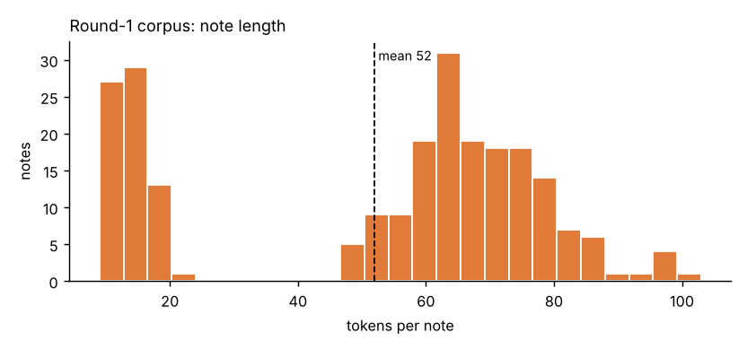
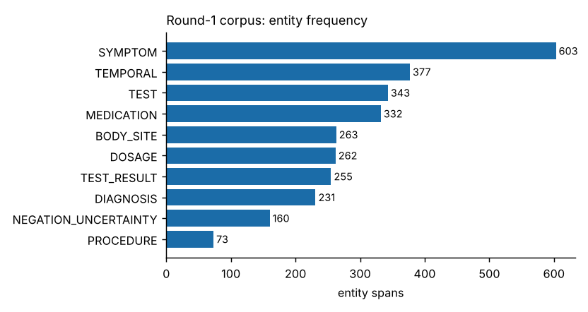
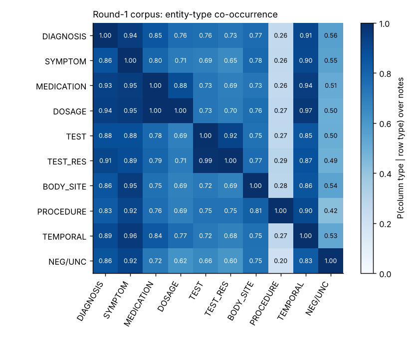

*This summary describes the **final** validated corpus `data/round1/annotated_corpus.csv`
(the Round-1 notes n001–n040 with 8 documented corrections + 192 new notes). Numbers are generated by code from the file.*

# 1. Corpus size

* Notes: **232** (Round 1 submission: 40) · tokens: **12060** (Round 1: 612; organisers' recommendation ≈ 10 000)
* Tokens per note: mean 52, median 62, min 9, max 103
* Entity spans: **2899** (12.5 per note on average; min 2, max 25); notes without any entity: 0
* Domains (project label, not an official field): 23 — largest: Respiratory 30, Gastroenterology 27, Cardiology 26, Dermatology 23

{ width=70% }

# 2. Entity frequency distribution

| entity type | spans | distinct forms | notes containing | share % |
|--------------------------|--------|----------------|------------------|---------|
| SYMPTOM | 603 | 221 | 206 | 20.8 |
| TEMPORAL | 377 | 114 | 193 | 13.0 |
| TEST | 343 | 144 | 162 | 11.8 |
| MEDICATION | 332 | 184 | 173 | 11.5 |
| BODY_SITE | 263 | 147 | 169 | 9.1 |
| DOSAGE | 262 | 135 | 153 | 9.0 |
| TEST_RESULT | 255 | 188 | 151 | 8.8 |
| DIAGNOSIS | 231 | 179 | 189 | 8.0 |
| NEGATION_UNCERTAINTY | 160 | 20 | 123 | 5.5 |
| PROCEDURE | 73 | 50 | 59 | 2.5 |

{ width=70% }

Every one of the 10 types now has at least 73 spans (Round 1: most types < 30). `PROCEDURE` is the rarest type; in outpatient notes most clinical acts are tests or prescriptions.

# 3. Domain distribution

| domain | notes | share % |
|------------------|-------|---------|
| Respiratory | 30 | 12.9 |
| Gastroenterology | 27 | 11.6 |
| Cardiology | 26 | 11.2 |
| Dermatology | 23 | 9.9 |
| General Medicine | 21 | 9.1 |
| Infectious | 19 | 8.2 |
| Endocrine | 14 | 6.0 |
| Neurology | 8 | 3.4 |
| Psychiatry | 8 | 3.4 |
| Orthopaedics | 8 | 3.4 |
| Paediatrics | 8 | 3.4 |
| Renal | 7 | 3.0 |
| Obstetrics | 6 | 2.6 |
| Eye | 6 | 2.6 |
| Gynaecology | 5 | 2.2 |
| Hematology | 3 | 1.3 |
| ENT | 3 | 1.3 |
| Surgery | 3 | 1.3 |
| Urology | 2 | 0.9 |
| Emergency | 2 | 0.9 |
| Rheumatology | 1 | 0.4 |
| Hepatology | 1 | 0.4 |
| Dental | 1 | 0.4 |

# 4. Co-occurrence and relationships between entity types

Within-note co-occurrence (diagonal = notes containing the type). Row-normalised heat-map below: *P(column type present | row type present)*.

{ width=75% }

Most frequent type pairs:

| type A | type B | notes containing both |
|------------|-------------|-----------------------|
| SYMPTOM | TEMPORAL | 186 |
| DIAGNOSIS | SYMPTOM | 178 |
| DIAGNOSIS | TEMPORAL | 172 |
| MEDICATION | SYMPTOM | 164 |
| MEDICATION | TEMPORAL | 163 |
| DIAGNOSIS | MEDICATION | 161 |
| BODY_SITE | SYMPTOM | 161 |
| DOSAGE | MEDICATION | 153 |
| TEST | TEST_RESULT | 149 |
| DOSAGE | TEMPORAL | 148 |

Reading: P(DOSAGE | MEDICATION) = 0.88, P(TEST_RESULT | TEST) = 0.92,
P(TEMPORAL | SYMPTOM) = 0.90, P(NEGATION_UNCERTAINTY | DIAGNOSIS) = 0.56.
These are the patterns a prescription/exam template produces; with 232 notes they are descriptive, not clinical findings.

Diagnosis → medication pairs seen at least twice, ranked by lift (lift > 1 = more often together than by chance):

| diagnosis | medication | co_notes | n_a | n_b | lift | pmi |
|----------------------|------------------|----------|-----|-----|---------|-------|
| স্থিতিশীল অ্যানজাইনা | সরবিট্রেট | 2 | 2 | 2 | 100.500 | 6.650 |
| হাইপোথাইরয়েডিজম | লিভোথাইরক্সিন | 2 | 2 | 2 | 100.500 | 6.650 |
| হারপিস জোস্টার | অ্যাসাইক্লোভির | 2 | 2 | 2 | 100.500 | 6.650 |
| তীব্র আর্টিকারিয়া | ক্যালামাইন লোশন | 2 | 2 | 3 | 67.000 | 6.070 |
| দাদ | টারবিনাফিন ক্রিম | 2 | 3 | 2 | 67.000 | 6.070 |
| মাইগ্রেন | সুমাট্রিপ্টান | 2 | 3 | 2 | 67.000 | 6.070 |
| ইসকিমিক স্ট্রোক | অ্যাটরভাস্টাটিন | 2 | 2 | 4 | 50.250 | 5.650 |
| কিডনিতে পাথর | টামসুলোসিন | 2 | 2 | 4 | 50.250 | 5.650 |

# 5. Data-quality checks

* empty tokens: 0 · invalid tags: 0 · official `validate.py`: **PASS, 0 errors, 0 warnings**
* exact duplicate notes: 0 · max character-4-gram Jaccard between any two notes: **0.45** (threshold 0.6)
* max character-5-gram Jaccard between any of our notes and any organiser-released test note: **0.28** (no copying)
* every entity type has ≥ 50 spans; the corpus contains short informal notes, structured outpatient notes, shorthand (`C/O … Dx … Rx`) notes and admission/discharge summaries.
* consistency audit: same-surface/different-type conflicts were inspected; the one systematic problem (organ + symptom written both as one SYMPTOM and as BODY_SITE + SYMPTOM) was corrected — see `docs/ANNOTATION_CONVENTIONS.md` rule C7.

# 6. Annotation edge cases (for clinician review)

| topic | decision | where |
|---|---|---|
| organ + symptom (`বুকে ব্যথা`) | split: BODY_SITE + SYMPTOM; idioms such as `মাথা ঘোরা` stay one SYMPTOM | C7 |
| units in results (`১১০/৭০ মি.মি. পারদ`) | unit is inside TEST_RESULT | C6 |
| imaging name with organ (`বুকের এক্স-রে`) | `বুকের` = BODY_SITE, `এক্স-রে` = TEST (organisers' worked example) | C5 |
| endoscopy / dressing / nebulisation | PROCEDURE; imaging and lab → TEST | C10 |
| negation | marker only (`নেই`, `না`, `সন্দেহ`) | C11 |
| history diagnoses | DIAGNOSIS (no separate history label in the schema) | C9 |
| `সকালে`, `রাতে` | TEMPORAL for symptoms, DOSAGE for when to take a drug | C2/C3 |
| hyphen suffix tokens (`ইসিজি-তে`) | whole token tagged | C13 |

# 7. Limitations

* Notes are **synthetic**, drafted by an AI assistant with the team; the corpus measures consistency with one author's patterns, not real clinical language.
* **No clinician review**, no second annotator, no inter-annotator agreement.
* Domain balance is uneven; some specialties have only 2–6 notes.
* Whitespace tokenisation keeps Bengali case endings attached (`ডায়াবেটিসের`), so span boundaries include them (same as the organisers' worked example).
